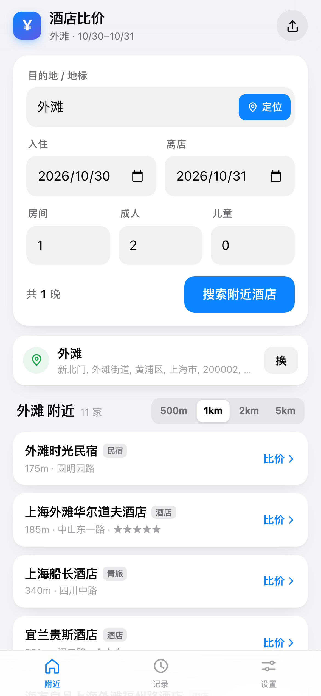
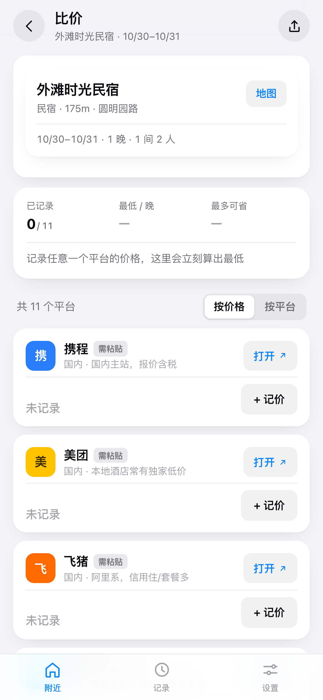

# 酒店比价助手 v2

> **定位 / 输入目的地 → 看周边有哪些酒店 → 选中一家 → 11 个平台逐个核价 → 自动算差价。**

移动端优先的 Web App（PWA）。前端纯静态无依赖，地理数据走 OpenStreetMap 公共接口，不需要任何 API key。



---

## 1. 现在就能用

电脑和 iPhone 在同一 Wi-Fi，Safari 打开：

```
http://192.168.10.216:8080
```

重启服务：

```bash
cd hotel-compare
node serve.js        # PORT=9000 node serve.js 可换端口
```

> 换网络后 IP 会变，重启会打印新地址。

### 装到主屏

Safari 打开（**别用微信内置浏览器**）→ 分享 ⤴ → 添加到主屏幕 → 添加。之后点开是全屏、无地址栏。

---

## 2. ⚠️ iPhone 上「真定位」必须 https

这是 iOS 的硬规则，不是代码问题：**Safari 只在 https 页面下给定位权限**。

| 你打开的地址 | 定位按钮 | 其他功能 |
|---|---|---|
| `http://192.168.x.x:8080`（局域网） | ❌ 点了会提示，并说明原因 | ✅ 全部可用 |
| `https://xxx.github.io/...`（部署后） | ✅ 正常 | ✅ 全部可用，且能离线 |

**不影响主流程**：直接输「上海外滩」「东京银座」效果和定位完全一样，只是少了「不用打字」这一步。

想用真定位 → 见第 6 节，部署到 https 只要 3 分钟（GitHub Pages 免费）。

---

## 3. 两步用起来

### 第一步：找附近酒店

- 点 **定位**：拿 GPS → 反查街道名 → 拉周边酒店（要 https）
- 或输目的地：`上海外滩` / `东京银座` / `西湖`，同名地点会列出来让你选
- 半径切换：**500m / 1km / 2km / 5km**
- 结果按**直线距离**排序，显示：名称、类型（酒店/民宿/青旅/公寓）、步行距离、门牌街道、星级

### 第二步：选中一家去比价

点任意一行 → 进入这家酒店的比价页：

- 11 个平台卡片，**能带参数的直接落到搜索结果页**（Agoda / Booking / Expedia / Hotels.com / Airbnb / 携程带城市ID）
- 带不了参数的（美团 / 飞猪 / 去哪儿 / 同程 / Trip.com）点「打开」会**自动复制酒店名**，进去长按粘贴
- 看到价格 → 回来点「+ 记价」→ 填每晚价或总价 → 自动算总价、均价、与最低价的差额
- 最低价绿框高亮，可按价格排序；右上角一键复制纯文本比价表发微信



> 每家酒店的价格是**分开存**的，来回切换不会串。附近列表里已比过的酒店会直接显示「¥xxx/晚 · 最低平台」。

---

## 4. 附近酒店的数据从哪来

| 用途 | 服务 | 说明 |
|---|---|---|
| 地名 → 坐标 | [Nominatim](https://nominatim.openstreetmap.org) | 免 key，中文模糊匹配 |
| 坐标 → 周边酒店 | [Overpass API](https://overpass-api.de) | 查 `tourism=hotel/guest_house/hostel/apartment/resort` |
| 兜底 | [Photon](https://photon.komoot.io) | Overpass 挂了时按名称检索酒店类 POI |

工程上的处理：

- **4 个 Overpass 镜像并发竞速**，谁先返回有效结果用谁，其余立即取消
- 18 秒总预算，超时自动降级到 Photon
- 结果**本地缓存 12 小时**（按坐标+半径做 key），反复进出同一片区域不走网络
- 如果浏览器直连被 CORS 挡住，自动回落到 `serve.js` 提供的同源代理 `/api/geo/*`
- 拉不到数据时给出明确提示 + 重试按钮，并提供「按目的地直接比价」的后路

**覆盖率的实话**：OSM 在北上广深和海外大城市覆盖不错（外滩 1km 内能拉到 20+ 家真实酒店），但在三四线城市可能只有几家。这不是 bug，是众包地图的现状。想要全国无死角的 POI，得接高德/百度（要实名申请 key），`geo.js` 里预留了替换位置。

---

## 5. 为什么价格还是手动记

- **同源策略**：网页 JS 读不到 booking.com 的 DOM，跨域抓价必须先有后端代理
- **动态渲染 + 风控**：房价是 XHR 拉的，有登录墙和反爬（携程会因 URL 参数不合规直接跳登录页——这也是本项目为什么带全 `flexType/cityId/provinceId/...`）
- **条款风险**：未经授权抓取房价违反平台条款

所以这里做的是最不容易失效的那一半：**把参数精确带到每个平台**（以前要手输 5 次），价格 3 秒录入一家。

想全自动 → 需要官方或第三方 API，见第 8 节。

---

## 6. 部署到 https（解锁定位 + 离线）

纯静态，不需要构建。

**GitHub Pages**

```bash
cd hotel-compare
git init && git add . && git commit -m "hotel compare v2"
git remote add origin git@github.com:javis603/hotel-compare.git
git push -u origin main
# 仓库 Settings → Pages → Source: main / root
```

打开 `https://javis603.github.io/hotel-compare/`，定位就能用了。

**Cloudflare Pages / Vercel**：拖文件夹上传，Build command 留空，Output dir 填 `.`。

> 部署到纯静态托管后，`/api/geo/*` 代理不存在，前端会自动改走直连——前提是上游允许跨域（Nominatim 和 Overpass 都返回 `Access-Control-Allow-Origin: *`）。

---

## 7. 数据与隐私

- 价格、记录、设置：只存在本机 `localStorage`（`hpc.v2`），不上传
- 地理查询：只把「地名」或「坐标+半径」发给 OpenStreetMap 公共接口，无账号、无埋点
- 定位：只在点「定位」时读取一次，不后台追踪
- 清除 Safari 网站数据会一起清空，重要记录请用右上角「复制摘要」另存

---

## 8. 想接实时价 / 更全的 POI

| 需求 | 方案 | 门槛 |
|---|---|---|
| 真·实时房价 | Booking/Agoda/Expedia 官方联盟 API、Trip.com 联盟 | 企业资质 + 审批 |
| 个人可用的聚合价 | Travelpayouts(Hotellook)、SerpApi Google Hotels、Apify | 按次计费，约 $5–50 / 1000 次 |
| 全国 POI 更全 | 高德 / 百度 Web 服务 API | 实名申请 key，免费额度够个人用 |
| 国内房价 | 携程/美团/飞猪开放平台 | 基本只对签约渠道开放 |

升级路径：先跑通这个版本的真实使用流程 → 确认高频 → 再接一个聚合 API 做「点一下出全网价」，后端只需一个 30 行的转发函数（顺便藏 key）。

---

## 9. 目录结构

```
hotel-compare/
├── index.html            # 三个视图：附近 / 记录 / 设置 + 比价子页
├── styles.css            # 移动端优先 + 深色模式 + 安全区适配
├── app.js                # 状态机、渲染、记价、历史、复制
├── platforms.js          # 11 个平台的品牌色 + 深链规则（加平台改这里）
├── geo.js                # 定位 / 地名搜索 / 附近酒店（多源 + 缓存 + 降级）
├── manifest.webmanifest  # PWA 清单
├── sw.js                 # 离线缓存（https 下生效）
├── serve.js              # 零依赖静态服务器 + /api/geo 代理
├── icons/                # 180/192/512 图标
├── gen_icons.py          # 图标生成脚本
└── shots/                # 截图
```

加一个平台 = 在 `platforms.js` 加一个对象，`link(ctx)` 返回 URL，UI 自动渲染。

---

## 10. 已知限制

- **定位要 https**（见第 2 节），局域网 http 下用不了，但搜目的地不受影响
- **OSM 覆盖不均**，小城市酒店可能很少；半径放大到 5km 仍为空时，用「按目的地直接比价」兜底
- **携程**需填城市 ID（设置页有北京/上海/广州/深圳快捷键），否则只开首页
- **美团/飞猪/去哪儿/同程/Trip.com** 没有稳定的公开 URL 协议，走「自动复制 + 粘贴」
- **价格口径不同**：含税/不含税/到店付/不含服务费。记价时用备注写清，否则差价会失真
- 深链规则可能随平台改版失效，`platforms.js` 改一行即可

---

*仅供个人比价参考。各平台名称与商标归其各自所有者，本项目与其无关联。*
